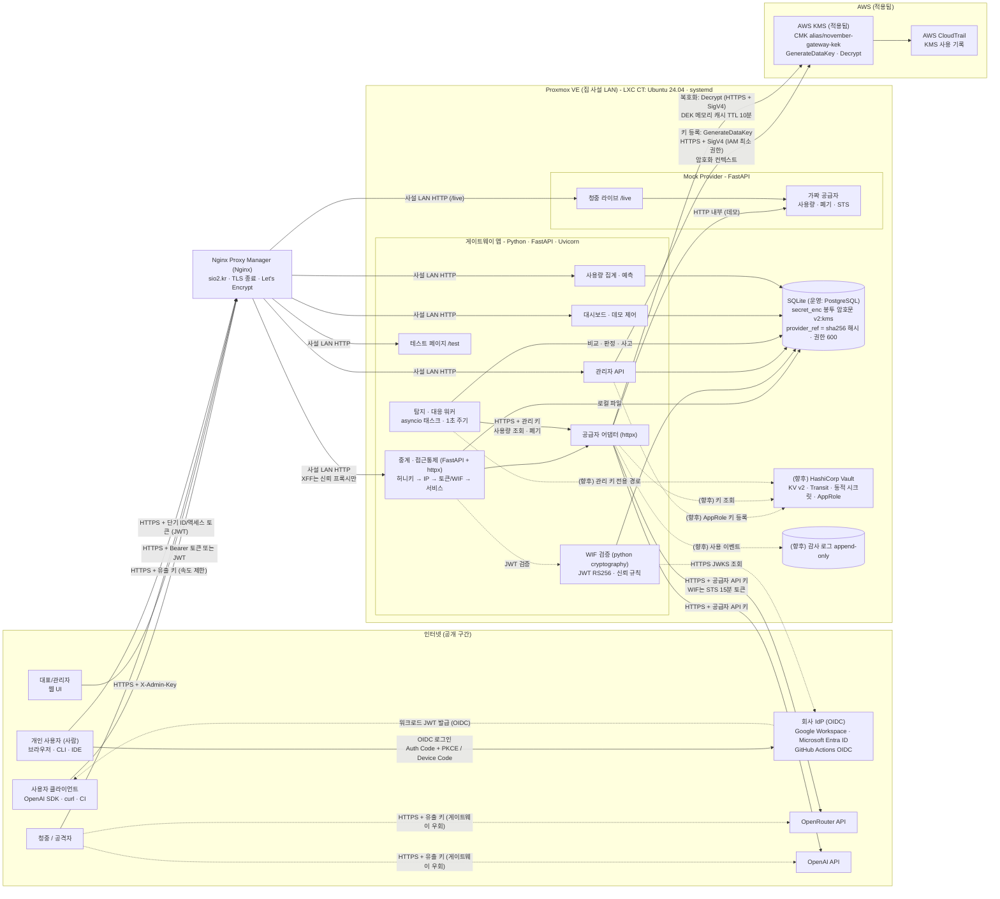
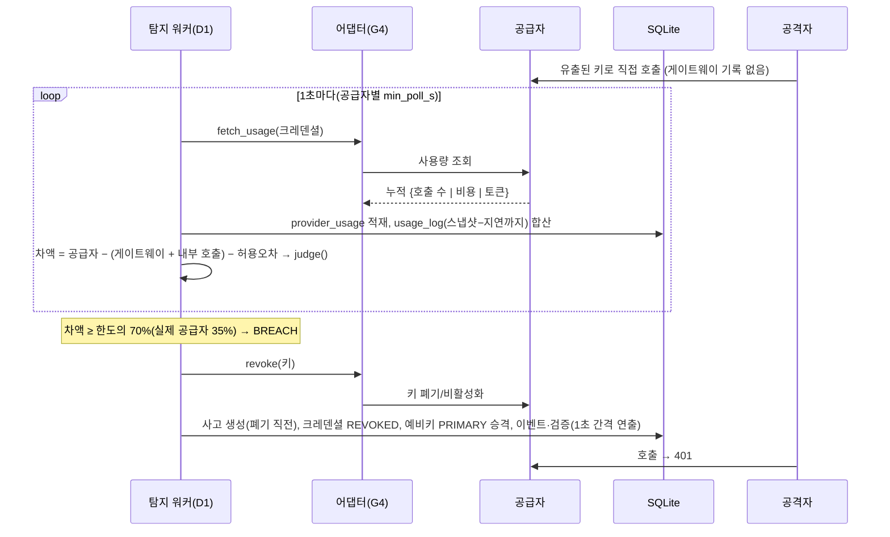
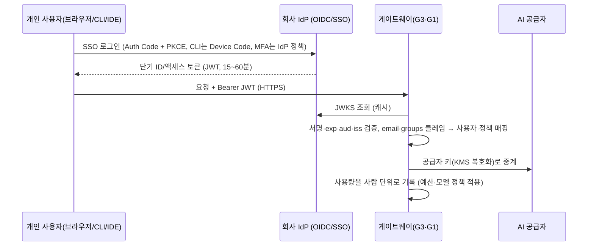

# 소프트웨어 아키텍처 설명 (다이어그램 작성용)

이 문서는 아키텍처 그림(컴포넌트도·시퀀스도·배포도)을 그리는 사람이 그대로 옮겨 그릴 수 있도록 구성요소, 연결, 신뢰 경계, 데이터 흐름을 정리한 것이다. 구현 현황 기준이며 해커톤 PoC 범위다.

## 1. 한 줄 요약
기업의 모든 AI API 호출을 하나의 게이트웨이로 모으고, **게이트웨이가 기록한 호출 수와 공급자가 보고한 사용량을 비교**해 키 유출(무단 사용)을 탐지하며, 탐지 즉시 그 키를 폐기하고 예비키로 전환한다.

## 2. 컴포넌트 목록 (그림의 박스)
### 2-1. 사용자·외부 행위자
| ID | 이름 | 설명 |
|---|---|---|
| U1 | 사용자 클라이언트(서비스·워크로드) | 사용자 PC·서비스·CI. OpenAI 호환 API로 게이트웨이를 호출. API 토큰 또는 워크로드 WIF(JWT)로 인증 |
| U2 | 대표(관리자) | 대시보드·테스트 페이지로 크레덴셜·한도·허용 IP·토큰을 관리(대표 대시보드 화면은 미구현, 현재는 `/test`) |
| U3 | 공격자 / 청중 | 유출된 키로 **공급자에 직접** 호출(게이트웨이 우회) |
| U4 | 회사 IdP (OIDC / SSO) | Google Workspace·Entra ID 등(사람 로그인), GitHub Actions·Kubernetes 등(워크로드). 단기 ID/액세스 토큰(JWT)을 발급한다. PoC는 로컬 가짜 IdP |
| U6 | **개인 사용자(사람)** | 회사 IdP로 SSO 로그인(브라우저는 Authorization Code + PKCE, CLI·IDE는 Device Authorization Grant)해 단기 토큰을 받아 게이트웨이를 호출. 사용량·예산이 **사람 단위**로 귀속된다(**목표 구성**, PoC는 서비스 단위 매핑) |

### 2-2. 게이트웨이 앱 (FastAPI, 한 프로세스, 포트 8000/8800)
| ID | 모듈 | 책임 |
|---|---|---|
| G1 | `gateway/router.py` — **중계·접근통제** | `/v1/chat/completions` OpenAI 호환 중계. 검사 순서: 허니키 일치(전체 토큰 폐기·서비스 정지) → 출발 IP(허용 CIDR, 0개면 모두 허용) → WIF JWT 또는 API 토큰 → 서비스 상태 → PRIMARY 크레덴셜 존재. 거부 로그 기록(허니키는 별도 `honeykey_event`) |
| G2 | `gateway/router.py` — **관리자 API** | 크레덴셜·CIDR·서비스(정지/재개)·토큰·설정·허니키 목록·거부 로그, 실제 공급자 키 프로비저닝(`/admin/{provider}/provision`) (`/admin/*`, X-Admin-Key) |
| G3 | `wif_inbound.py` — **WIF 검증(워크로드·개인 사용자)** | RS256 JWT 검증(서명·만료·audience·issuer, alg 화이트리스트), 신뢰 규칙(issuer + `sub` 패턴 → 서비스)으로 매핑, 로컬 데모 IdP(`/idp/*`). **목표**: 개인 사용자 토큰의 `email`·`groups` 클레임으로 사용자·정책(모델·예산)에 매핑 |
| G4 | `providers.py` — **공급자 어댑터** | mock / openrouter / openai 어댑터. `fetch_usage`(키별 누적: 호출 수·토큰·비용 중 있는 값), `revoke`, 응답 비용 추출, 지연(`lag_s`) |
| D1 | `detector/router.py` — **탐지·대응 워커** | 1초(`POLL_INTERVAL_S`, 공급자별 `min_poll_s`)마다 공급자 사용량 조회 → 게이트웨이 기록과 시점 정렬 비교 → 판정(NORMAL/SUSPECT/WARNING/BREACH) → 자동 대응 |
| D2 | `detector/router.py` — **대시보드 API·데모 제어** | 상태·차액·시계열·사고·이벤트 조회, 공격 시뮬레이터(Mock 전용), 리셋(`/demo/reset`, `/demo/reset-openrouter`·`-openai`), 정리(`/demo/cleanup-*`), 허니키 호출 |
| U5 | `usage.py` + `pricing.py` — **사용량 집계·예측** | 서비스별 토큰·비용 집계, 모델별 단가표 기반 예상 비용, 선형 월말 예측, 월 예산 |
| T1 | `testpage.py` + `static/test.html` | 디자인 없는 기능 테스트 페이지 `/test` |
| C1 | `contract.py`, `db.py`, `vault.py` | 공용 상수·판정 함수·`.env` 로드 / SQLite 스키마 / 공급자 키 암호화 모듈(**적용됨: `KEY_BACKEND=kms` AWS KMS 봉투 암호화(서버), `fernet`(로컬 개발·폴백)**) |
| C2 | `clientip.py` | 관리자 키 비교, 출발 IP 결정(신뢰 프록시 XFF·`X-Demo-Source-IP`), 공개 모드 가드(`/demo/*`·`/idp/token`). 게이트웨이·Mock 공용 |
| C3 | `main.py` | 앱 조립(라우터 5개 등록, CORS 전체 허용, 시작 시 `init_db`·워커 기동) |

### 2-3. 별도 서비스
| ID | 이름 | 설명 |
|---|---|---|
| M1 | **Mock Provider** (FastAPI, 포트 9000/9800) | OpenAI 호환 가짜 공급자: 키 검증·폐기·사용량 집계(2초 지연)·STS(WIF 단기 토큰). 선택적으로 실제 업스트림 패스스루 |
| M2 | **청중 라이브** `/live/*` (M1에 포함) | 청중 채팅 페이지, `/live/chat`(속도 제한·토큰 상한), `/live/stats`, 키 상태 |

### 2-4. 저장소
| ID | 이름 | 내용 |
|---|---|---|
| S1 | DB (SQLite `gateway.db`, 운영 전환 시 PostgreSQL) | setting, allowed_cidr, service, gateway_token(해시), credential(메타데이터, 마스킹, **`secret_enc` = 봉투 암호문 `v2:kms:...`**(감싼 DEK·nonce·암호문·`key_version`·`kek_id`), **`provider_ref` = API_KEY는 `sha256:<hex>` 해시만**), usage_log, provider_usage, access_denied_log, incident, event, honeykey, honeykey_event, trusted_identity. **평문 키는 DB에 없다**. DB 파일·`data/` 권한 600/700 (**적용됨**) |
| S2 | **AWS KMS** (**적용됨**) | CMK `alias/november-gateway-kek`(KEK, 반출 불가). 크레덴셜마다 `GenerateDataKey`로 DEK 생성, 복호화는 `Decrypt`. 암호화 컨텍스트 `{"app":"november","purpose":"provider-api-key"}` 바인딩. 최소 권한 IAM 사용자(해당 CMK에 `kms:GenerateDataKey`·`kms:Decrypt`만), 사용 기록은 CloudTrail |
| S3 | 감사 로그 (append-only) — **향후** | 키 등록·복호화·사용·폐기·교체 이벤트(키 값 제외). 현재는 KMS 호출만 CloudTrail에 남는다 |
| S4 | 관리 키 별도 경로 — **향후** | 공급자 관리 키(OpenRouter Management, OpenAI Admin). 현재는 환경변수, 중계와 같은 프로세스. 향후 별도 경로·탐지 워커 전용 신원 |
| S5 | **HashiCorp Vault** — **향후** | KV v2 키 보관, Transit, 동적 시크릿, AppRole 인증, 감사 장치. 현재 미적용(키 보관은 S1 암호문 + S2 KMS) |

### 2-5. 외부 AI 공급자
| ID | 이름 | 사용량 조회 | 키 폐기 | 반영 지연(실측) |
|---|---|---|---|---|
| P1 | Mock | `/usage` | `/revoke` | 2초 / 즉시(어댑터 값 0.5초) |
| P2 | OpenRouter | `GET /keys/{hash}` 사용액(USD) | `PATCH disabled` | 약 6초 / 최대 약 20초 (호출 수 API는 당일 미지원) |
| P3 | OpenAI | Usage API `num_model_requests` 1분 버킷 | 서비스 계정 삭제 | 95~381초(실측 2회, 편차 큼) / 약 3초 |

### 2-6. 해커톤 데모 전용 구성 (아키텍처 그림에서 제외)
- **vLLM(자체 GPU)**: 앞단 게이트웨이가 키별 계량·폐기를 제공하는 자체 호스팅 공급자(`vllm` 어댑터, `/demo/reset-vllm`). 해커톤 데모 전용 구성이다. 실제 시스템 아키텍처 그림에는 포함하지 않는다. 실제 공급자 대신 무료 GPU로 청중 라이브·공격 시뮬레이터를 돌리기 위한 시연용이며, 인터페이스는 `docs/vllm-gateway-spec.md`에 있고, 숙소 쪽 NPM이 `https://vllm.dorm.sio2.kr`로 TLS 종료해 서비스한다.

### 2-7. 기술 스택 한눈에
| 계층 | 기술 | 용도 |
|---|---|---|
| 언어·런타임 | **Python 3**, **Uvicorn**(ASGI 서버), `asyncio` | 게이트웨이·Mock 구동, 백그라운드 탐지 워커 |
| 웹 프레임워크 | **FastAPI**(+ Pydantic) | 중계·관리·대시보드·사용량 API, 테스트 페이지 서빙 |
| HTTP 클라이언트 | **httpx** | 공급자 중계(스트리밍 포함), 사용량 조회·폐기 호출, JWKS 조회 |
| 암호·토큰 | Python **cryptography**(**AES-256-GCM**, Fernet 폴백, RSA/RS256 검증), **JWT**, **OIDC / OAuth 2.0**(PKCE, Device Authorization Grant) | 공급자 키 암호화, 사용자·워크로드 WIF 토큰 검증 |
| 저장소 | **SQLite**(PoC) → **PostgreSQL**(운영) | 사용량 로그, 크레덴셜(암호문), 사고·이벤트 |
| 키 관리(**적용됨**) | **AWS KMS**(CMK `alias/november-gateway-kek`, 봉투 암호화), **boto3**(KMS 호출, SigV4), **AWS IAM**(최소 권한 사용자), **AWS CloudTrail**(KMS 사용 기록) | 공급자 키 봉투 암호화, KEK 반출 불가 |
| 키 관리(향후) | **HashiCorp Vault**(KV v2·Transit·동적 시크릿·AppRole) | 키 보관 서버화, 관리 키 별도 경로 |
| 진입점·TLS | **Nginx Proxy Manager**(Nginx), **Let's Encrypt** 와일드카드 인증서 | TLS 종료, 도메인 라우팅, `/live` 경로 분기 |
| 서버·가상화 | **Proxmox VE**, **LXC**(Ubuntu 24.04), **systemd** | 게이트웨이 CT 구동·자동 재시작 |
| 네트워크(임시/보조) | **Tailscale**(**WireGuard**) | 이전 임시 구성에서 사용, 현재 목표 구성은 Proxmox 사설 LAN |
| 신원 제공자 | **Google Workspace**, **Microsoft Entra ID**, **GitHub Actions OIDC** | 사람·워크로드 OIDC 토큰 발급 |
| AI 공급자 | **OpenAI API**, **OpenRouter API** | 모델 호출, 키별 사용량·폐기 API |
| 문서·도구 | **Mermaid**, Markdown, **Git/GitHub** | 다이어그램·문서·형상 관리 |
- 로고 출처 URL과 사용 조건은 `docs/tech-stack-logos.md`에 정리했다(이미지는 저장소에 넣지 않음). 약 34개 항목 중 14개는 공식 URL을 열어 확인했고, 나머지는 "부분" 또는 "확인 불가"이므로 그림에 쓰기 전에 디자이너가 공식 페이지에서 직접 확인한다. 로고가 없는 개념(OAuth, PKCE, Device Authorization Grant 등)은 텍스트 박스로 그린다. 이 프로젝트는 비상업 해커톤 발표용이라 표의 로고를 모두 사용해도 되며(표기 의무·변형 금지는 유지, 상업 전환 시 재검토), 근거는 `docs/tech-stack-logos.md` 0절에 있다. 해커톤 데모 전용 구성(vLLM)은 이 표와 아키텍처 그림에서 제외한다.

## 3. 컴포넌트 다이어그램 (Mermaid)

**범례**: 실선 = 정상 경로(적용됨), 점선 = 보조·우회 경로(청중/공격자의 직접 호출은 게이트웨이를 거치지 않음) 또는 **(향후)** 표시된 미적용 구성(Vault·감사 로그·관리 키 경로). 구간별 프로토콜은 5-1절 표 참조.

## 4. 핵심 시퀀스
### 4-1. 정상 호출
1. 사용자가 `Authorization: Bearer <API 토큰 또는 JWT>`로 `POST /v1/chat/completions`.
2. G1: 허니키 아님? → 허니키로 차단된 IP 아님? → 출발 IP ∈ 허용 CIDR?(등록된 대역이 없으면 통과) → G3가 JWT 검증 또는 토큰 해시 일치 → 서비스 ACTIVE?
3. 현재 `PRIMARY ACTIVE` 크레덴셜 선택, `secret_enc`의 감싼 DEK를 S2(KMS `Decrypt`, DEK 캐시 10분)로 풀어 AES-256-GCM 복호화(WIF 크레덴셜은 STS 단기 토큰) → 공급자로 중계, 스트리밍 포함.
4. 응답이 200이고 `usage`(또는 비용)가 있으면 `usage_log` 1행 기록 → 응답 반환(업스트림 401·네트워크 오류는 502).

### 4-2. 탐지와 자동 대응
판정 방식은 레거시(허용 무단 호출 수 한도 × 공급자별 비율)가 기본이고, 사용자가 사용량 방식(공급자 보고 중 모르는 호출 %, 기본 5·10·20%) 또는 건수 방식(기본 1·5·10건)을 고르면 그 임계로 판정한다(contract.md O절). 허용 오차는 관리자 설정 `tolerance_calls`(기본 0), 게이트웨이 쪽에는 내부 호출(승격 검증·폐기 확인)과 진행 중 요청을 더한다. 워커 주기 1초(`POLL_INTERVAL_S`), 속도 제한 공급자는 어댑터 `min_poll_s`(OpenRouter 3초, OpenAI 15초)마다만 조회(contract.md P절).

- 폐기 실패 처리(계약 N절): 폐기 요청은 최대 3회 재시도하고 유출 키로 1토큰 호출해 401인지 **확인**한다. 확인 전에는 사고를 닫지 않고 BLOCKED를 유지하며 `revoke_guard`가 3~30초 간격으로 재폐기, 청중 경로(`/live/chat`)는 Mock 폐기 목록으로 즉시 막는다. 폐기 확인 후 30분 동안 공급자 호출이 다시 늘면 `REVOKE_NOT_EFFECTIVE`로 재폐기.
- 판정: 한도(허용 무단 호출 수, 기본 100)의 10% SUSPECT / 50% WARNING / 70% BREACH. 공급자 지연이 큰 경우(OpenRouter·OpenAI) 비율을 5% / 20% / 35%로 낮춘다(`contract.RATIOS`).
- 안전 경로: 공급자 값이 게이트웨이 **전체** 기록을 넘으면 확실한 유출(정상 호출은 항상 게이트웨이에 먼저 기록되므로 오탐 없음).
- 비용만 주는 공급자는 비용 차이로 비교하고 호출 수를 평균 호출 비용으로 추정한다(`calls_estimated`).
- 분 버킷을 주는 공급자(OpenAI)는 반영이 끝난 버킷 경계까지 누적 비교.

### 4-3. 워크로드 WIF (서비스·CI) — PoC 구현됨
1. 사용자 서비스(CI·서버)가 IdP에서 단기 JWT(RS256)를 받는다.
2. 게이트웨이(G3)가 JWKS로 서명, `exp`, `aud`, `iss`를 검증하고 `sub`가 신뢰 규칙에 맞는지 확인 → 서비스로 매핑.
3. 이후는 4-1의 3~4단계와 동일.

### 4-3-1. 개인 사용자 WIF (사람) — 목표 구성(PoC는 같은 JWT 경로의 `sub` 매핑까지)

- **장기 비밀이 없다**: 사용자는 API 키를 받지 않고, 토큰은 짧게 살며 갱신은 IdP가 한다.
- **오프보딩 즉시 반영**: IdP에서 계정을 비활성화하면 토큰이 만료되고 갱신이 거부되어 접근이 사라진다(게이트웨이 토큰 폐기가 따로 필요 없다).
- **귀속과 정책**: `sub`/`email`로 사용량을 사람 단위로 집계하고, `groups` 클레임으로 허용 모델·월 예산을 정한다(그룹 → 정책 매핑 테이블).
- **PoC와의 차이**: PoC는 JWT의 `sub` 패턴을 서비스에 매핑하는 단계까지 구현되어 있다(서비스 단위 귀속). SSO 로그인 화면, Device Code, 그룹 기반 정책, 사람 단위 예산은 설계만 있다.

### 4-4. 허니키
게이트웨이에 심어 둔 가짜 토큰으로 접근 → 호출자에게는 평범한 401, 내부에서 `honeykey_event`·사고(HONEYKEY)·**전체 게이트웨이 토큰 즉시 폐기 + 모든 서비스 일시 정지**(재발급·재개는 관리자 수동).

### 4-5. 청중 라이브
청중 폰 → `/live`(M2) → `/live/chat`이 유출 키로 공급자에 호출 → 탐지 워커가 차이를 감지해 키 폐기 → 청중 화면에 401/"차단되었습니다".

## 5. 신뢰 경계 (그림에서 점선 영역)
1. **인터넷 ↔ NPM(hack.sio2.kr)**: 공개 영역. 공개 모드에서 `/demo/*`·`/admin/*`·`/idp/token`은 관리자 키 필요, `/docs` 비활성.
   - **경고**: 데모 관리자 키는 고정값 `admin`이라 추측 가능하다. 공개 서버에서는 NPM 단 접근 제한(IP·인증)을 함께 걸어야 한다.
   - 사용자 중계 `/v1`의 IP 제한은 기본 꺼짐(허용 CIDR 0개 = 모두 허용). 관리자가 대역을 등록해야 제한된다.
2. **NPM ↔ 게이트웨이(Proxmox 사설 LAN)**: 신뢰 프록시. 게이트웨이 CT는 NPM에서만 접근하도록 Proxmox 방화벽으로 제한한다. `X-Forwarded-For`는 신뢰 프록시일 때만 인정.
3. **게이트웨이 ↔ 공급자**: 실제 키는 DB에 봉투 암호문으로만 있고(KEK는 KMS 밖으로 나가지 않음), 평문은 사용 순간 메모리에만 잠깐 있다. `provider_ref`에는 해시만 있다. 사용자는 키를 보지 못한다.
3-2. **사용자·워크로드 ↔ 회사 IdP ↔ 게이트웨이**: 인증은 IdP가 하고(MFA·계정 상태), 게이트웨이는 토큰 검증과 정책 매핑만 한다. 신뢰 대상은 등록된 issuer와 `sub`·`groups` 규칙뿐이다.
3-1. **게이트웨이(Proxmox CT, AWS 밖) ↔ AWS KMS** (적용됨): HTTPS(TLS) + SigV4 서명, 해당 CMK에 `GenerateDataKey`·`Decrypt`만 허용된 최소 권한 IAM 사용자. 액세스 키는 `/opt/november/.env.server`(권한 600)에 있다 — **한계**: 장기 액세스 키이므로 운영은 IAM Roles Anywhere 또는 AWS 안의 IAM 역할로 바꾼다. 평면별(등록/사용/탐지) 신원 분리와 Vault·감사 로그는 **향후**. 상세는 `docs/key-security-design.md`.
4. **공격자 ↔ 공급자**: 게이트웨이를 통과하지 않는 경로. 이 경로가 사용량 대조의 탐지 대상이다.

## 5-1. 통신 구간별 보안 프로토콜 (가볍게)

| # | 구간 | 전송 보호 | 인증·무결성 | 비고 |
|---|---|---|---|---|
| 1 | 사용자/청중 → NPM(`sio2.kr`) | HTTPS (TLS, Let's Encrypt `*.sio2.kr`, HTTP/2, SSL 강제) | 사용자: Bearer API 토큰(서버는 SHA-256 해시만 보관) 또는 OIDC JWT(RS256) / 청중: 유출 키 + IP당 호출 속도 제한 | 허용 IP 대역은 선택(미설정 시 모두 허용) |
| 2 | 관리자 → NPM → `/admin/*`·`/demo/*` | HTTPS | `X-Admin-Key` 헤더(상수시간 비교), 공개 모드에서 `/docs` 비활성 | 데모 서버는 고정 키(약함) — 운영은 SSO·역할 기반 |
| 3 | NPM → 게이트웨이(Proxmox CT) | 같은 사설 LAN(Proxmox 브리지)의 HTTP — 공개 인터넷에 노출되지 않음 | 신뢰 프록시 IP에서 온 `X-Forwarded-For`만 인정, CT 방화벽은 NPM만 허용 | 운영에서는 내부 TLS(mTLS) 권장 |
| 4 | 게이트웨이 → AI 공급자(OpenAI·OpenRouter) | HTTPS (TLS 1.2+, 시스템 CA 검증) | 공급자 API 키(Bearer). WIF 크레덴셜은 STS 15분 단기 토큰 | 키는 봉투 암호문을 KMS로 풀어 요청마다 사용 |
| 5 | 탐지 워커 → 공급자 사용량·폐기 API | HTTPS | 별도 관리 키(OpenRouter Management, OpenAI Admin) — 환경변수로만 보관 | 최소 권한 키 권장 |
| 6 | 사용자 서비스 → IdP → 게이트웨이(WIF) | HTTPS(JWKS 조회) | JWT 서명(RS256만 허용, alg 화이트리스트), `exp`·`aud`·`iss` 검증, 신뢰 규칙(`sub` 패턴) | PoC는 로컬 가짜 IdP(HTTP) |
| 7 | 게이트웨이 → 저장소(DB, 같은 호스트) | 로컬 파일(권한 600, `data/` 700) | 공급자 키는 **봉투 암호화**(크레덴셜별 DEK로 AES-256-GCM, `v2:kms:...` 한 문자열에 감싼 DEK·nonce·암호문·`key_version`·`kek_id`), `provider_ref`는 `sha256:` 해시만, 토큰은 SHA-256 해시, 응답·로그엔 마스킹만 (**적용됨**) | 기존 Fernet 암호문·원문 `provider_ref`는 읽기 호환, `scripts/rekey_credentials.py`로 일괄 재암호화 |
| 9 | 게이트웨이 → AWS KMS (**적용됨**) | HTTPS (TLS) | **SigV4 서명 + 최소 권한 IAM 사용자**(CMK `alias/november-gateway-kek`에 `kms:GenerateDataKey`·`kms:Decrypt`만), **암호화 컨텍스트** `{"app":"november","purpose":"provider-api-key"}`, KEK 반출 불가, CloudTrail 기록 | DEK는 프로세스 메모리에 TTL 10분 캐시(디스크·로그 금지). 한계: 장기 액세스 키를 `.env.server`(600)에 보관 |
| 10 | 게이트웨이 → HashiCorp Vault (**향후**) | HTTPS (TLS) | AppRole 인증, 평면별 정책 | 미적용 |
| 11 | 게이트웨이 → 감사 로그 (**향후**) | HTTPS (TLS) | append-only, 키 값 미포함 | 미적용(현재는 KMS 호출만 CloudTrail) |
| 12 | 개인 사용자 ↔ 회사 IdP / → 게이트웨이 | HTTPS (TLS) | OIDC **Authorization Code + PKCE**(브라우저), **Device Authorization Grant**(CLI·IDE), 단기 토큰(15~60분), 게이트웨이는 RS256 서명·`exp`·`aud`·`iss`·`groups` 검증 | 장기 비밀 없음, 오프보딩은 IdP 비활성화로 즉시 반영, 사람 단위 귀속(목표 구성) |
| 8 | 공격자 → 공급자(우회 경로) | HTTPS | 유출된 키 | 게이트웨이를 거치지 않으므로 **사용량 대조로 탐지** |

- 요약: **바깥(인터넷) 구간은 모두 TLS(NPM에서 종료), 내부 구간은 Proxmox 사설 LAN**, 애플리케이션 계층 인증은 구간마다 토큰·키·JWT로 나뉜다.
- 한계: 사설 LAN 안의 NPM→게이트웨이는 평문 HTTP다. 데모용 IdP·STS는 HTTP. KMS 인증은 AWS 밖 서버라 장기 IAM 액세스 키를 쓴다. 남은 격차는 `docs/key-security-design.md` 8절. 향후 mTLS, IAM Roles Anywhere, Vault·감사 로그를 적용한다.

## 6. 배포 구조
- **로컬 개발**: Mock 9000 + 게이트웨이 8000, SQLite 파일, `scripts/dev.ps1`.
- **목표 구성(아키텍처 결정)**: **Nginx Proxy Manager(NPM)가 게이트웨이의 단일 진입점**이다. NPM이 TLS(`*.sio2.kr` 와일드카드)를 종료하고 `hack.sio2.kr`를 **Proxmox 위의 게이트웨이 서버(LXC CT)**로 프록시하며, `/live`만 같은 CT의 Mock(9000 계열 포트)으로 라우팅한다. CT 안에서는 게이트웨이(8000)·Mock·SQLite를 systemd로 구동하고, CT 방화벽은 NPM의 접근만 허용한다. 배포는 `pve-deploy` 절차(CT 생성 → 앱 배포 → NPM 프록시 + 인증서)를 따른다.
- **현재 구동 상태(실제 적용됨)**: 위 목표 구성이 적용되어 있다. Proxmox CT 1003(`hack-gw`, 172.30.1.43)에서 게이트웨이(8000)·Mock(9000)을 systemd로 구동하고, NPM 프록시 호스트 18(`sio2.kr`, 인증서 9번 `sio2.kr`)이 `172.30.1.43:8000`으로, `/live`는 `:9000`으로 프록시한다. `hack.sio2.kr`는 NPM **리다이렉션 호스트**(301, 경로·쿼리 보존, 인증서 `*.sio2.kr`)로 `https://sio2.kr`에 연결한다. 환경파일 `/opt/november/.env.server`(공개 모드, `TRUSTED_PROXIES`=NPM 172.30.1.101, 실제 AI 키 없음). 재배포는 `scripts/deploy_test_server.sh 1003`. (이 PC + Tailscale 구동 방식은 중단되었다. `scripts/run_test_server.ps1`은 로컬 점검용으로만 남긴다.)
- 환경변수: `PUBLIC_MODE`, `ADMIN_KEY`, `TRUSTED_PROXIES`, `DEMO_MODE`(기본 1, 로컬 IdP·`X-Demo-Source-IP`), `MOCK_BASE_URL`, `DB_PATH`, `KEY_BACKEND`(`kms`|`fernet`, 서버=kms), `VAULT_KEY`(fernet용, 기본값 없음 — 로컬은 미설정 시 `data/.vault_key` 자동 생성, 서버는 필수), AWS 자격 증명(KMS 최소 권한 IAM 사용자, `.env.server` 권한 600), `LEAKED_KEY`, `IDP_ISSUER`, `UPSTREAM_API_KEY`·`UPSTREAM_BASE_URL`(Mock 실제 AI 패스스루), `LIVE_MODEL`, `OPENROUTER_MANAGEMENT_KEY`, `OPENAI_ADMIN_KEY`·`OPENAI_PROJECT_ID`. 테스트 서버는 실제 키 3종(`UPSTREAM_API_KEY`·`OPENROUTER_MANAGEMENT_KEY`·`OPENAI_ADMIN_KEY`)을 지운 채 실행한다(Mock만).

## 7. 그림 작성 가이드
- **레이어**: 행위자 → (NPM) → 게이트웨이 앱(중계·탐지·관리) → 어댑터 → 공급자, 좌우로 저장소(DB·KMS·감사 로그·관리 키 저장소)를 둔다. **KMS 봉투 암호화는 적용된 구성이므로 실선으로**, Vault·감사 로그·관리 키 별도 경로는 **향후 구성이므로 점선·회색으로** 구분한다.
- **화살표 색 구분 권장**: 정상 호출(실선), 탐지 조회(파선), 공격 경로(빨강), 자동 폐기(굵은 선).
- **강조할 것**: ① 공격자 경로가 게이트웨이를 우회한다 ② 탐지 워커가 공급자 값과 게이트웨이 기록을 **서로 다른 경로로** 얻어 비교한다 ③ 폐기·승격 후에도 사용자 경로는 끊기지 않는다.

- **WIF 두 종류를 함께 그린다**: 워크로드 WIF(서비스·CI → JWT)와 개인 사용자 WIF(사람 → 회사 IdP SSO → 단기 토큰). 개인 사용자 WIF는 목표 구성이므로 PoC 구현 범위와 구분해 표시한다.
- **구간 라벨**: 화살표마다 5-1절의 프로토콜(HTTPS/TLS, 사설 LAN HTTP, Bearer, JWT 등)을 짧게 표기한다.
- **그림에 넣지 않을 것**: vLLM(자체 GPU) 구성(2-6절)은 해커톤 시연 전용이라 컴포넌트도·시퀀스도·배포도에 그리지 않는다.

- 다중 키 분할 관리(인당 1키, 테넌트별 KEK, 예비 키 풀, 과금 계량)는 `docs/multi-key-management-design.md` 참조. 공급자 API 키 보관 설계(봉투 암호화, KMS, 평면 분리, 현재 격차와 로드맵)는 `docs/key-security-design.md` 참조.

## 8. 한계와 운영 전환
**적용됨(키 보관)**: AWS KMS 봉투 암호화(크레덴셜별 DEK, AES-256-GCM, 암호화 컨텍스트, `key_version`·`kek_id`), `VAULT_KEY` 고정 기본값 제거, `provider_ref` 해시화, DB·환경파일 권한 600/700, 키 값 로그·응답 마스킹, CloudTrail에 KMS 사용 기록.

| 현재 | 남은 것(향후) |
|---|---|
| SQLite | Postgres 등 외부 DB, 이중화 |
| KMS 인증은 장기 IAM 액세스 키(`.env.server` 600) | IAM Roles Anywhere 또는 AWS 안의 IAM 역할 |
| 키 보관 = DB 암호문 + KMS | **HashiCorp Vault**(KV v2·Transit·동적 시크릿·AppRole), 테넌트별 KEK, 정기 키 교체 자동화 |
| 앱 감사 로그 없음(KMS 호출만 CloudTrail) | append-only 감사 로그 저장소 |
| 관리 키(OpenRouter Management·OpenAI Admin)가 환경변수, 중계와 같은 프로세스 | 별도 경로·탐지 워커 전용 신원 |
| 단일 프로세스 워커 | 별도 워커·큐, 공급자별 폴링 격리 |
| Mock/로컬 IdP | 실제 IdP(JWKS 캐시·키 교체) |
| 고정 관리자 키 | SSO·역할 기반 접근 |
| 서비스 단위 JWT 매핑(`sub`→서비스, 로컬 IdP) | **개인 사용자 WIF**: 회사 IdP SSO(PKCE·Device Code), `email`·`groups` 클레임 기반 사람 단위 귀속·모델·예산 정책, 오프보딩 즉시 반영 |
| 공급자 지연만큼 탐지 지연 | 공급자 한도·알림과 병행, 지연을 사용자에게 명시 |
- 게이트웨이 자체가 침해되면 키 사용 권한까지 노출될 수 있다. DB만 유출되면 KEK가 KMS에 있어 풀 수 없고, DEK 캐시는 10분으로 짧으며, KMS 사용은 CloudTrail에 남는다. 그 밖에는 허니키와 사용량 대조로 침해를 탐지한다.
