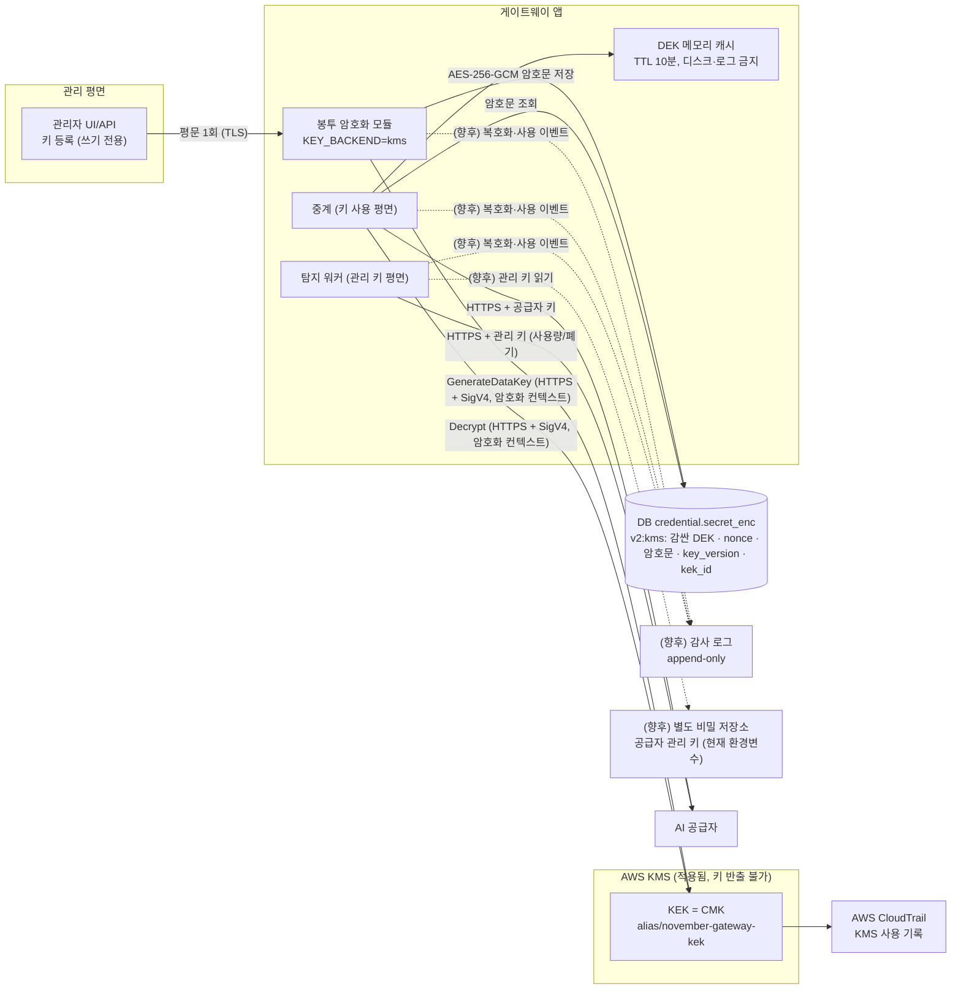

# 공급자 API 키 안전 보관 설계

게이트웨이가 OpenAI·OpenRouter 같은 **AI 공급자의 API 키**를 보관·사용·교체할 때의 설계다. 목표는 ① 키가 평문으로 저장되지 않는다 ② 한 곳이 뚫려도 피해가 키 전체로 번지지 않는다 ③ 키를 쓰는 모든 순간이 기록된다 ④ 유출이 의심되면 즉시 교체한다.

## 1. 위협 모델
| 위협 | 예 | 막는 장치 |
|---|---|---|
| DB·백업 유출 | `gateway.db` 파일 복사, 백업 탈취 | 키는 **암호문만** 저장, 암호화 키(KEK)는 DB와 다른 곳(KMS) |
| 호스트 침해 | 게이트웨이 서버에서 셸 획득 | 키 사용 권한 분리, 짧은 수명 키, 사용 감사·이상 탐지 |
| 내부자·관리자 | 관리자 계정이 키를 읽음 | **쓰기 전용 등록**(읽기 API 없음), 마스킹 표시만, 접근 감사 |
| 로그·화면 노출 | 로그에 키 출력, 오류 메시지 | 키 값 로깅 금지, 응답엔 마스킹만 |
| 소스 저장소 노출 | `.env`·기본 키 커밋 | 기본 키 상수 금지, 비밀 스캔(CI), `.gitignore` |
| 메모리 덤프 | 프로세스 메모리 | 평문은 사용 순간에만 짧게 보유, 캐시 TTL |
| 공급자 측 키 유출(이 시스템의 대상) | 개발자 PC·저장소에서 키 유출 | 사용량 대조 탐지 → 자동 폐기·예비키 승격 |

## 2. 설계 원칙
1. **WIF 우선**: 공급자가 지원하면 장기 키를 아예 저장하지 않고 단기 토큰만 쓴다(키를 훔칠 대상이 없다).
2. **키가 필요하면 봉투 암호화(Envelope Encryption)**: 키마다 데이터 키(DEK)로 암호화하고, DEK는 KMS의 마스터 키(KEK)로 감싼다.
3. **최소 권한·평면 분리**: 등록(관리) / 사용(중계) / 탐지(관리 키) 권한을 서로 다른 신원으로 나눈다.
4. **읽기 불가 등록**: 키는 넣을 수만 있고 꺼내 볼 수 없다. 화면과 API는 마스킹(`sk-...a9f2`)만.
5. **짧게 쓰고 자주 바꾼다**: 사용 시점에만 복호화, 정기 교체 + 유출 의심 시 즉시 교체(예비키 승격은 이미 구현).
6. **모든 사용을 기록한다**: 누가·언제·어떤 크레덴셜을 복호화했는지(값은 제외).

## 3. 키 계층과 저장 구조

- **KEK**(마스터 키): KMS 안에서만 존재(CMK `alias/november-gateway-kek`), 앱은 `GenerateDataKey`·`Decrypt`만 호출한다.
- **DEK**(키별 데이터 키): 크레덴셜마다 KMS `GenerateDataKey`로 새로 만든다. AES-256-GCM으로 공급자 키를 암호화하고, **암호화 컨텍스트** `{"app":"november","purpose":"provider-api-key"}`를 묶어 암호문을 다른 용도로 옮겨 붙이지 못하게 한다. 복호화한 DEK는 프로세스 메모리에 TTL 10분 캐시(디스크·로그 금지).
- **DB 저장 항목**: `credential.secret_enc` 한 문자열(`v2:kms:...`)에 감싼 DEK(`wrapped_dek`)·nonce·암호문·`key_version`·`kek_id`. `provider_ref`는 API_KEY의 경우 `sha256:<hex>`(식별·중복 확인용)만, 원문은 저장하지 않는다(공급자 호출에 원문이 필요하면 `secret_enc`를 복호화해 호출 시점에만 메모리에). 기존 원문 행은 호환 읽기.
- **공급자 관리 키**(OpenRouter Management, OpenAI Admin)는 폐기·생성까지 가능한 **가장 강한 키**다. 현재는 환경변수로 중계와 같은 프로세스에 있다. **향후** 다른 저장소·탐지 워커 전용 신원으로 분리한다.

### 3-1. 현재 적용 구성: AWS KMS 봉투 암호화
- **백엔드 선택** `KEY_BACKEND=kms|fernet`. 서버 = `kms`, 로컬 개발 기본 = `fernet`. Fernet 백엔드의 `VAULT_KEY`는 **기본값이 없다**: 로컬은 미설정 시 무작위 키를 만들어 `data/.vault_key`(권한 600)에 저장해 쓰고, 서버(공개 모드)는 환경변수 필수.
- **KMS 인증**: 서버(Proxmox CT)는 AWS 밖이라 **최소 권한 IAM 사용자**(해당 CMK에 `kms:GenerateDataKey`·`kms:Decrypt`만)의 액세스 키를 `/opt/november/.env.server`(권한 600)에 둔다. 호출은 HTTPS(TLS) + SigV4 서명, 사용 기록은 CloudTrail.
- **한계**: 장기 액세스 키가 서버 파일에 있다. 운영은 IAM Roles Anywhere 또는 AWS 안의 IAM 역할로 바꾼다.
- **이관**: 기존 Fernet 암호문은 읽기 호환되고 `scripts/rekey_credentials.py`로 KMS 봉투 암호문으로 일괄 재암호화한다.
- **권한·로그**: DB 파일·`.env.server`·`data/` 권한 600/700. 키 값은 로그·응답에 남기지 않고 마스킹만.

### 3-2. 향후: HashiCorp Vault
- KV v2 키 보관(DB에는 경로만), Transit, 동적 시크릿(가능한 공급자의 단기 키), AppRole 인증과 평면별 정책(등록=쓰기 전용 / 사용=읽기 / 탐지=관리 키 경로), Vault 감사 장치. 테넌트별 KEK는 `docs/multi-key-management-design.md`. 모두 **미적용**.

## 4. 저장 방식 비교
| 방식 | 설명 | 장점 | 한계 | 단계 |
|---|---|---|---|---|
| **A. Fernet + 환경변수 키** | 앱 프로세스가 `VAULT_KEY`로 암호화(기본값 없음, 로컬은 `data/.vault_key` 자동 생성) | 구현 단순 | 키와 암호문이 같은 호스트 | **로컬 개발·폴백** |
| **B. 봉투 암호화 + KMS** | 위 3절 구조 | KEK 반출 불가, CloudTrail 기록 | KMS 의존, 호출 지연(DEK 캐시 10분으로 완화) | **적용됨(서버)** |
| **C. Vault/Secrets Manager 동적 키** | 필요할 때 공급자에 단기 키를 발급(JIT), TTL 후 자동 폐기 | 장기 키가 없다 | 공급자가 키 발급 API 지원 필요(OpenRouter·OpenAI 서비스 계정은 가능) | 향후 |
| **D. WIF** | 단기 토큰만 | 저장할 비밀 없음 | 공급자 지원 필요 | 가능하면 최우선(Mock STS로 PoC) |

## 5. 런타임 규칙
- 복호화는 **사용 순간**에만 한다. KMS로 푼 DEK는 프로세스 메모리 캐시에 TTL 10분으로만 두고 디스크·로그·예외 메시지에 쓰지 않는다. 교체·폐기 이벤트가 오면 캐시를 즉시 비운다.
- 키를 명령행 인자·URL·쿼리에 넣지 않는다(헤더로만). 환경변수에 평문 키를 두지 않는다.
- 시크릿 파일은 권한 600, 소유 서비스 계정만. 서비스는 비특권 사용자로 실행.
- 응답·로그에는 마스킹(`앞3자...뒤4자`)과 `credential_id`만 남긴다.
- **유출 의심 시 순서**: 공급자에서 폐기 → 예비키 승격 → 사고 기록 → 폐기된 암호문 삭제(또는 `REVOKED`로 잠금). 이 흐름은 현재 구현된 자동 대응과 같다.

## 6. 교체·비상 절차
- **정기 교체**: 예비키를 주 키로 승격 → 새 예비키 생성 → 옛 키 폐기. 주기 예: 30일.
- **KEK 교체**: KMS 자동 교체, DEK를 새 KEK로 다시 감싼다(공급자 키 자체는 그대로).
- **비상(Break-glass)**: 게이트웨이 침해가 의심되면 모든 공급자 키를 일괄 폐기하는 절차를 문서화하고 분기별로 훈련한다.

## 7. 감사와 탐지
- **감사 로그**: 키 등록·복호화·사용·폐기·교체 이벤트(시각, 행위자 신원, `credential_id`, 결과). append-only 저장소로 보낸다.
- **허니 크레덴셜**: 보관소에 가짜 공급자 키를 심어 두고, 그 키가 쓰이면 즉시 경보(게이트웨이의 허니키와 같은 발상).
- **비밀 스캔**: 저장소·CI에서 키 패턴 탐지(`sk-`, `sk-or-` 등).
- **사용량 대조**(이 시스템의 핵심): 위 보호가 뚫려 키가 새도 공급자 사용량과 게이트웨이 기록의 차이로 탐지해 폐기한다. 키 보관은 "새지 않게", 대조는 "새도 빨리 막게"를 맡는 두 겹의 방어다.

## 8. 격차 현황 (해소 / 잔여)
서버는 `KEY_BACKEND=kms`(AWS KMS 봉투 암호화), 로컬 개발은 `fernet`이다. 항목별 상태는 다음과 같다.

| # | 격차(이전) | 상태 | 현재 |
|---|---|---|---|
| 1 | `VAULT_KEY` 미설정 시 코드의 고정 문자열로 키 생성 | **해소** | 기본값 제거. 로컬은 무작위 키를 `data/.vault_key`(600)에 생성, 서버는 환경변수 필수. 서버 기본 백엔드는 KMS |
| 2 | `credential.provider_ref`에 API 키 원문 저장 | **해소** | API_KEY는 `sha256:<hex>`만 저장, 원문이 필요하면 `secret_enc`를 복호화해 호출 시점에만 메모리에. 기존 원문 행은 호환 읽기(재암호화 스크립트로 정리) |
| 3 | DB 파일 권한 644, 암호화 키와 같은 호스트 | **해소** | DB·`.env.server`·`data/` 600/700, KEK는 KMS(반출 불가) |
| 4 | 암호화 컨텍스트·키 버전 없음 | **해소** | 암호화 컨텍스트 바인딩, 암호문에 `key_version`·`kek_id` 포함 |
| 5 | 복호화·사용 감사 로그 없음 | **잔여** | KMS 호출(`GenerateDataKey`·`Decrypt`)은 CloudTrail에 남지만, 앱 단 감사 로그(누가 어떤 크레덴셜을 썼는지)는 없다 |
| 6 | 공급자 관리 키가 환경변수, 중계와 같은 프로세스 | **잔여** | 그대로. 별도 경로·탐지 워커 전용 신원은 향후 |
| 7 | 관리자 키 고정값 `admin`, `/demo/*` 응답에 유출 키 포함 | **잔여** | 데모 서버 그대로. 운영은 SSO·역할 기반 |
| 8 | 정기 교체 일정·비상 절차 없음 | **잔여** | 6절 절차 미자동화 |
| 9 | (신규) KMS 인증용 장기 IAM 액세스 키가 서버 파일에 있음 | **잔여(한계)** | 최소 권한·권한 600으로 완화. 운영은 IAM Roles Anywhere 또는 AWS 안의 IAM 역할 |

> 키가 사람·팀 단위로 늘어나는 B2B 구조(테넌트별 KEK, 인당 1키, 예비 키 풀)는 `docs/multi-key-management-design.md` 참조.

## 9. 단계별 로드맵
| 단계 | 내용 | 효과 |
|---|---|---|
| **P1 — 완료** | `VAULT_KEY` 기본값 제거, `provider_ref` 원문 제거(해시), DB·환경파일 권한 600/700, 키 값 로깅 금지 | 격차 1~3 해소 |
| **P2 — 완료** | `KEY_BACKEND`(kms 또는 fernet), KMS 봉투 암호화 백엔드(DEK·AES-256-GCM·암호화 컨텍스트·`key_version`·`kek_id`), `scripts/rekey_credentials.py` | 격차 3·4 해소, KEK 반출 불가 |
| P3 (향후) | append-only 감사 로그, 관리 키 별도 경로·전용 신원, 허니 크레덴셜, IAM Roles Anywhere | 격차 5·6·9 |
| P4 (향후) | HashiCorp Vault, 테넌트별 KEK, WIF·동적(JIT) 키, 정기 교체 자동화, 비상 훈련 | 격차 8, 저장할 장기 키 최소화 |

## 10. 아키텍처 그림에 넣을 것
- **적용됨(실선)**: KMS(CMK `alias/november-gateway-kek`), 봉투 암호화 모듈, 암호문 DB(`secret_enc`), CloudTrail. 화살표 라벨: `GenerateDataKey`·`Decrypt`(HTTPS + SigV4, 최소 권한 IAM), 암호화 컨텍스트, DEK 캐시 10분.
- **향후(점선·회색)**: HashiCorp Vault, append-only 감사 로그, 관리 키 별도 경로, 테넌트별 KEK.
