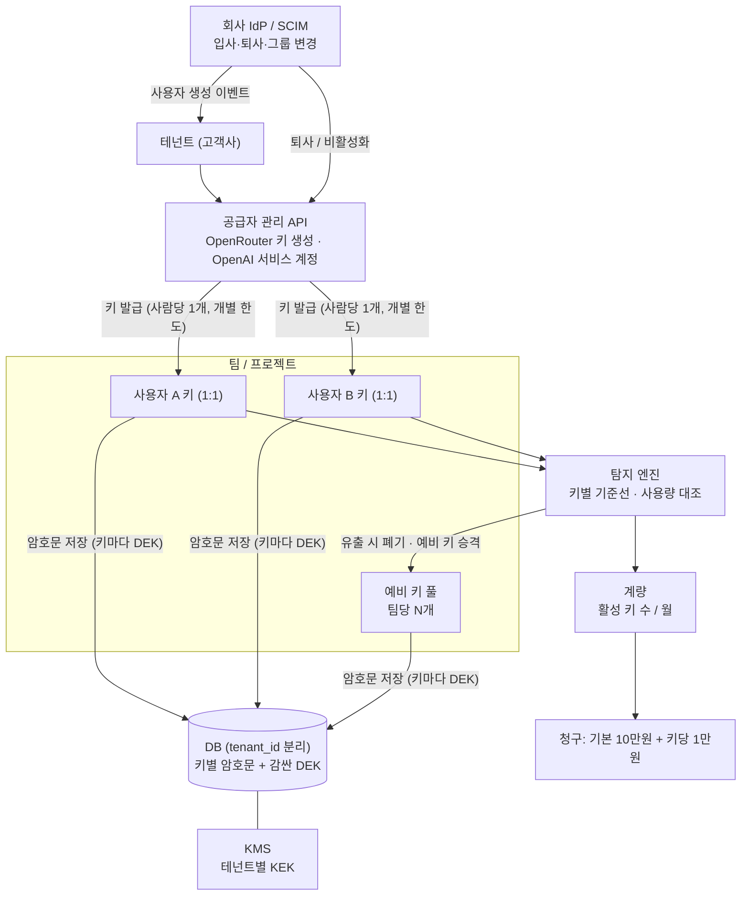
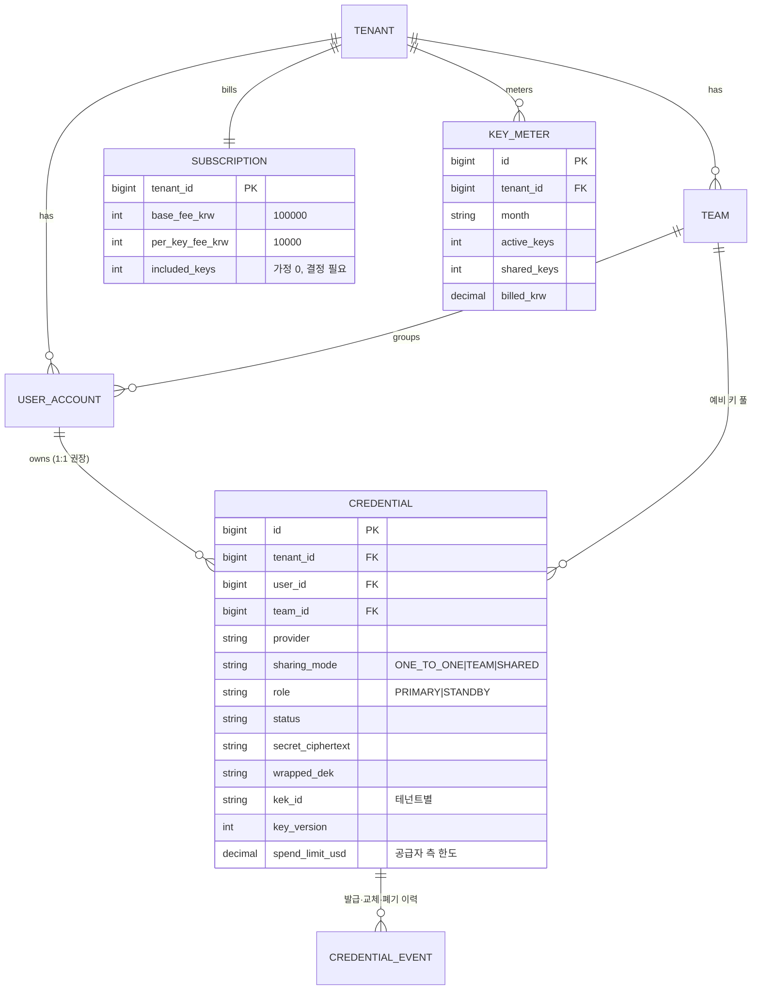

# 다중 키 분할 관리 설계 (B2B 과금 모델 연계)

> 목표 구성의 설계 문서다. PoC 코드는 단일 조직·수동 등록 수준이며, 여기 적힌 테넌트 분리·자동 프로비저닝·과금 계량은 구현되어 있지 않다.

## 1. 사업 모델과 기술 요구
- **과금(담당자 설명 기준)**: 기본 구독료 **월 10만원** + 관리하는 API 키가 늘 때마다 **키 1개당 월 1만원** 추가. (기본 구독에 포함되는 키 수, 월 중 증감 정산 방식은 **미정**이라 아래에서 가정으로 표시한다.)
- **왜 키를 늘리도록 유도하는가**: 탐지는 "키별 공급자 사용량 vs 게이트웨이 기록" 비교다. 한 키를 여러 사람이 쓰면 ① 정상 사용량이 커서 기준선이 흐려지고 ② 누가 썼는지 귀속이 안 되며 ③ 유출되면 피해 범위가 넓다. 인당 1키(1:1)면 개인별 기준선이 선명해 작은 이상도 잡고, 키 하나가 새도 그 사람의 피해로 한정된다.
- **필요한 시스템**: 키가 수십~수천 개로 늘어도 ① 안전하게 보관 ② 사람·팀 단위로 분할 발급 ③ 자동으로 만들고 폐기 ④ 키별로 탐지·한도 ⑤ 키 개수를 정확히 계량해 과금.

## 2. 탐지 품질과 키 구조의 관계
| 키 구조 | 기준선 | 귀속 | 유출 피해 | 탐지 신뢰도 |
|---|---|---|---|---|
| **1:1 (인당 1키)** | 개인별로 좁다 | 사람 단위 | 1명 | 높음 |
| 1:팀(팀당 1키) | 팀 평균, 넓다 | 팀 단위 | 팀 전체 | 중간 |
| 1:N (여럿이 공유) | 매우 넓다 | 불가 | 전체 | 낮음 |
- 게이트웨이는 키마다 **탐지 신뢰도 등급**(1:1 / 팀 / 공유)을 계산해 대시보드에 보여 준다. 공유 키는 "탐지 한계"를 표시하고 분리를 권한다(과금 모델과 정합: 분리 = 키 증가 = 안전성 증가).
- **공유 회피 대응**: 비용을 아끼려고 키를 공유하는 것을 막기 위해 ① 공유율·탐지 신뢰도를 대시보드와 월 리포트에 노출 ② 엄격 모드(키 하나에 게이트웨이 사용자 신원 1명만 허용, 위반 시 경고·차단) 제공 ③ 계약 서비스 수준(탐지 보장 범위)을 1:1 키 비율에 연동.

## 3. 분할(Split) 관리 구조

- **분할의 의미**: 모든 크레덴셜을 한 키로 묶지 않고 **사람·팀 단위로 쪼개 발급**한다. 한 키가 유출돼도 그 키의 한도·범위로 피해가 제한되고, 다른 키는 영향을 받지 않는다.
- **키 계층**: 테넌트 → 팀/프로젝트 → 사용자 키. 각 키는 서로 다른 DEK로 봉투 암호화되고, **KEK는 테넌트마다 따로**(고객사 간 격리, 한 테넌트의 침해가 다른 테넌트의 키 복호화로 이어지지 않음). 상세는 `docs/key-security-design.md`.
- **예비 키 풀**: 팀마다 예비 키를 미리 준비해 두고, 유출 탐지 시 해당 사용자의 키를 폐기한 뒤 풀에서 즉시 승격한다(현재 PoC의 "예비키 승격"을 키 단위로 확장). 풀 크기는 팀 규모에 비례(예: 팀당 1~2개, 과금 대상 여부는 미정).
- **공급자 쪽 보조 안전장치**: 키마다 개별 지출 한도(예: OpenRouter 키 `limit`)와 모델 제한을 걸어, 탐지가 늦어지는 구간(공급자 지연)의 최대 손실을 잘라 둔다.

## 4. 키 수명 주기 자동화
| 단계 | 동작 | 트리거 |
|---|---|---|
| 발급 | 공급자 관리 API로 사람당 키 생성 → 암호화 저장 → 사용자·팀에 매핑 | IdP/SCIM의 사용자 생성, 관리자 요청 |
| 사용 | 사용자는 키를 보지 않는다. 게이트웨이가 그 사람의 키로 중계하고 사용량을 사람 단위로 기록 | 요청(WIF 또는 토큰 인증) |
| 탐지·대응 | 키별 사용량 대조 → 이상 시 폐기·예비 키 승격·알림 | 2초~공급자 지연 주기 |
| 교체 | 정기(예: 30일) 새 키 발급 → 전환 → 옛 키 폐기 | 스케줄 |
| 회수 | 퇴사·비활성화 즉시 키 폐기, 암호문 잠금 | IdP 이벤트 |
- 키 수가 늘수록 폴링 비용이 커지므로 공급자의 **일괄 조회**를 쓴다(OpenAI Usage API는 `group_by=api_key_id`로 조직 전체 키를 한 번에 조회, OpenRouter는 키 목록 API). 공급자 호출 한도(OpenAI 관리 API 분당 호출 제한 등)에 맞춰 배치·캐시.

## 5. 과금 계량 설계
- **과금 단위(가정)**: 월말 기준 **관리 중인 활성 키 수**. 활성의 정의 후보: ① 프로비저닝되어 상태가 ACTIVE인 키 ② 월 중 1회 이상 호출이 있었던 키. (예비 키 풀의 포함 여부, 월 중 증감 일할 계산은 미정.)
- **계산 예(가정: 기본 구독에 키 포함 수 0개)**: 키 10개 → 10만원 + 10×1만원 = 20만원, 키 100개 → 10만원 + 100×1만원 = 110만원. 기본 구독에 일정 수가 포함된다면 초과분에만 1만원을 곱한다(결정 필요).
- **계량 데이터**: 테넌트·월별 `active_keys`, `shared_keys`(1:N), 키별 상태 이력(발급·폐기 시각)을 남겨 분쟁 시 증빙한다. 청구 금액은 계량 이력에서 재계산 가능해야 한다.
- **대시보드 지표**: 키 수, 1:1 비율, 공유 키 수, 탐지 신뢰도 분포, 이번 달 예상 청구액.

## 6. 데이터 모델 추가 (목표 구성)

- 기존 PoC 테이블(`credential`, `usage_log`, `incident` 등)에 `tenant_id`·`user_id`를 더하고 `provider_ref`의 평문 키 저장은 해시 식별자로 바꾼다(`key-security-design.md` 8절).

## 7. 위험과 결정할 것
| 항목 | 내용 |
|---|---|
| 공유 회피 | 요금을 아끼려 키를 공유하면 탐지가 약해진다 → 신뢰도 노출·엄격 모드·SLA 연동으로 대응(2절) |
| 키 수 증가에 따른 보관 위험 | 키가 많을수록 노출 면적이 커진다 → 키마다 DEK, 테넌트별 KEK, 사용 감사(`key-security-design.md`) |
| 공급자 제약 | 키 생성 API가 없거나 서비스 계정에만 가능한 공급자가 있다. 키 생성이 불가한 공급자는 수동 등록으로 대체하고 1:1 보장이 약해진다 |
| 요금 구조 | 안전할수록 비용이 늘어 고객이 키 수를 줄이려 할 수 있다. 일정 수 포함·구간 할인·팀 단위 상품을 둘지 결정 |
| 예비 키 과금 | 예비 키 풀을 과금 대상에 넣을지(안전을 위한 키라 제외 권장) 결정 |
- 결정이 필요한 값: 기본 구독 포함 키 수, 활성 키의 정의, 예비 키 과금 여부, 월 중 증감 정산 방식.
